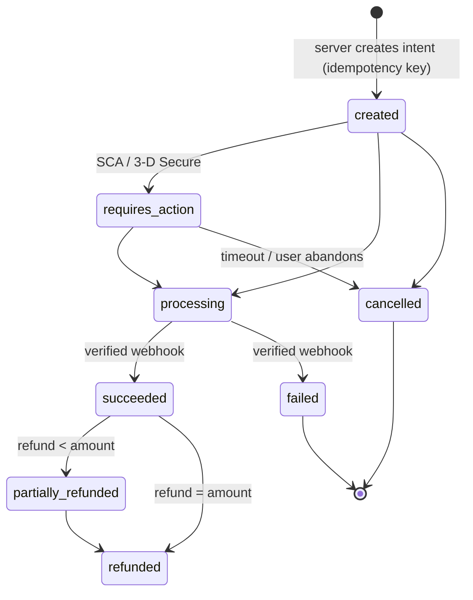
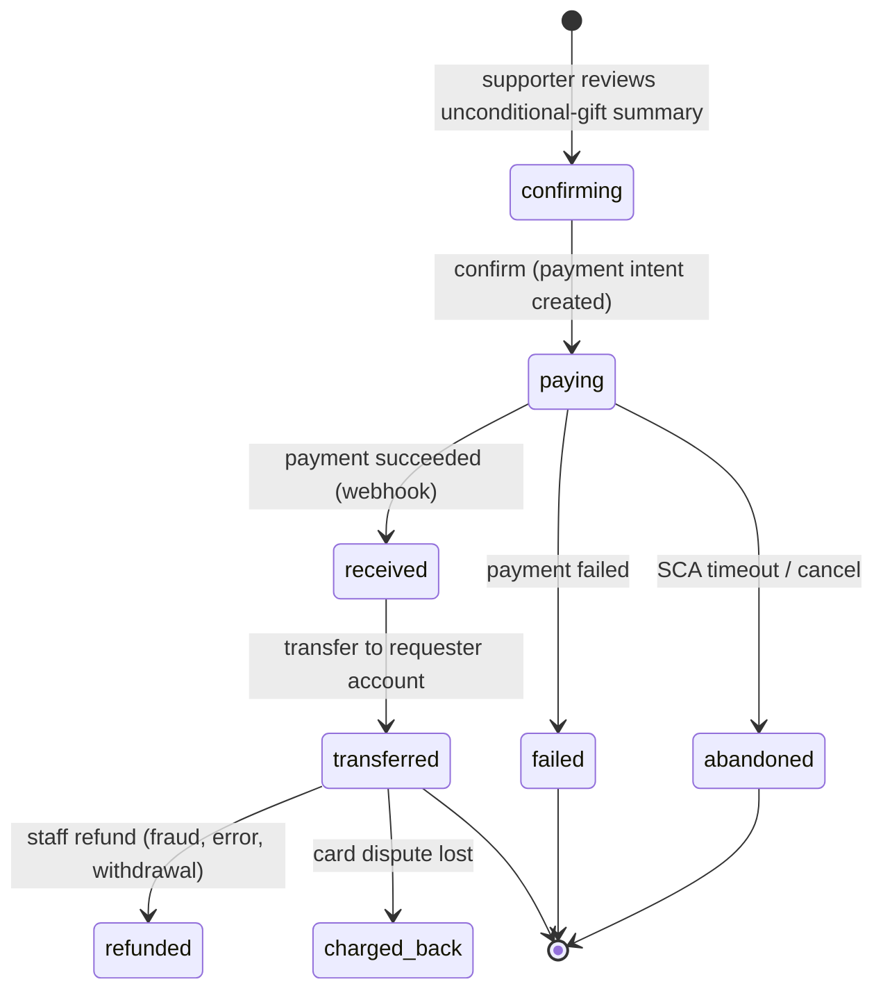
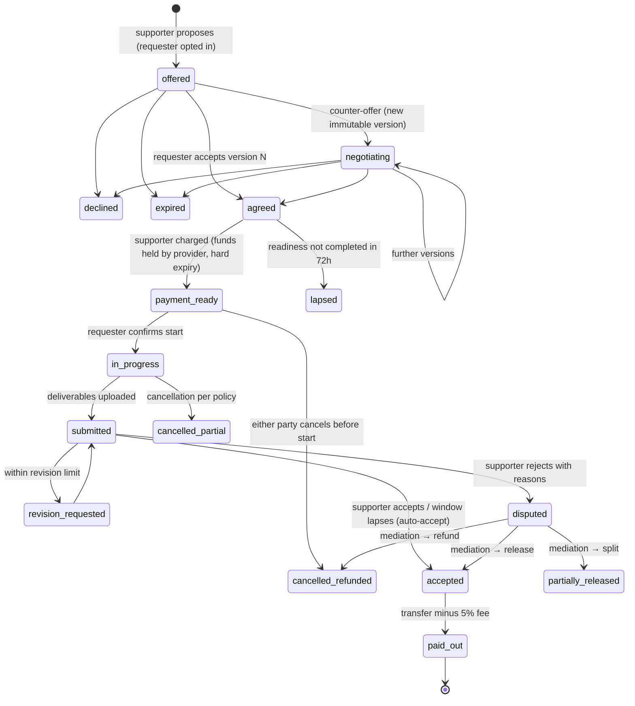
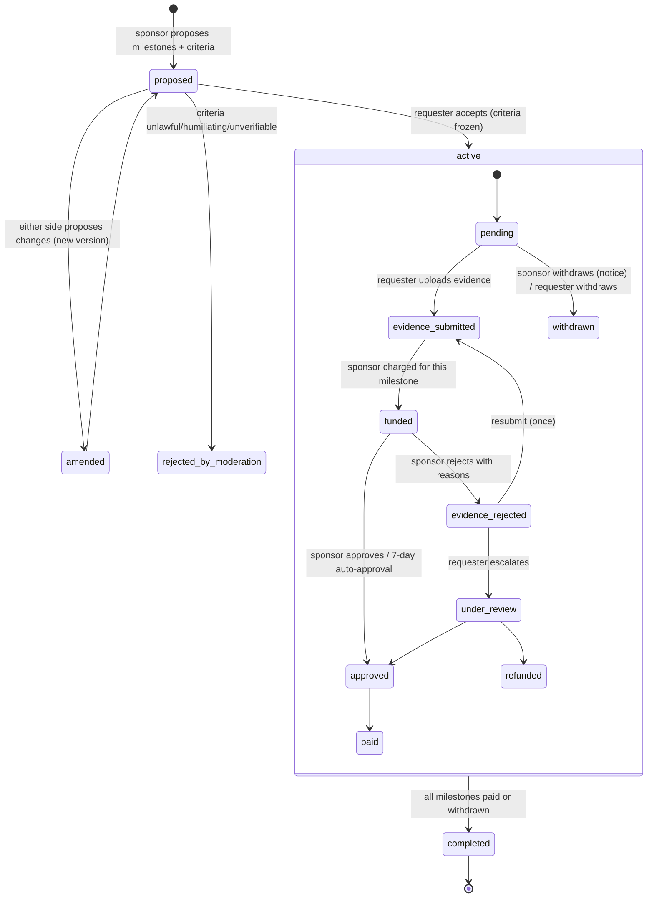
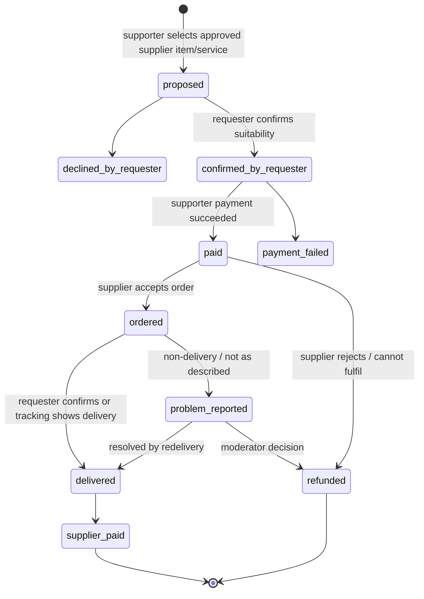

# SolveANeed — Agreement Engine Design (Phase 3/4)

**Status: DESIGN ONLY — not implemented.** Payments remain blocked in the database (`payment_transactions.livemode` must be false). Nothing here is approved by a payment provider or a lawyer; every provider assumption is marked **[VERIFY]**.

## 0. Principles that apply to all four workflows

1. **No generic escrow.** SolveANeed will not describe or operate funds as "held in escrow" unless a regulated provider has approved that exact arrangement in writing. Funds are only ever held **by the regulated provider**, on the provider's terms.
2. **SolveANeed never holds client money.** The working assumption is a regulated marketplace provider such as **Stripe Connect** with requesters (and suppliers) as connected accounts **[VERIFY eligibility, UK regulatory opinion — see COMPLIANCE_REGISTER #5]**.
3. **Holds are short and purposeful.** Stripe's documentation lets platforms hold funds in the platform balance before transferring, or in a connected account before paying out, but only up to country-specific limits (90 days in many countries) and only when there is a clear purpose and a commitment to transfer or pay out once an event occurs. The UK-specific limit is **[VERIFY]**. Every hold therefore has a hard expiry date, and when it expires the money is automatically refunded or released according to the agreed terms.
4. **Refunds and disputes hit the platform first.** With destination charges or separate charges and transfers, refunds and disputed amounts are debited from the platform balance. Exposure limits and reserves must be part of the financial model.
5. **One currency per agreement,** equal to the need's currency (enforced by database triggers). No FX conversion in Phase 3/4.
6. **Every state change is an audited RPC.** Clients never write agreement, payment or payout tables. Each transition writes `audit_events` and an `agreement_events` row (new table, §6).
7. **Idempotent and webhook-driven.** Payment state changes only come from signature-verified provider events (`provider_events`, unique `(provider, event_id)`), never from the browser.
8. **Blocks and suspensions stop everything.** No offer, message or agreement can be created between members where `is_blocked_between()` is true, or where either account isn't `active`.

### Shared payment state machine

This mirrors the `payment_status` enum. Refunds can never exceed the original payment (database trigger).

---

## 1. GIVE — Unconditional giving

| Aspect | Specification |
|---|---|
| **Participants & relationships** | Supporter (payer) → Requester (recipient). SolveANeed is the platform operator, not a party to the gift. A gift is a voluntary transfer with **no consideration**: there is no contract for services. Not a charitable donation (no Gift Aid) unless a registered charity is involved, which is out of scope **[VERIFY with counsel: fundraising/charity law]**. |
| **Required verification** | Supporter: signed in, active, payment method verified by the provider (SCA). Requester: need `published`; connected account onboarded with the provider's KYC complete (identity, bank account) **before** any gift is accepted. Gifts above a threshold (proposed £250) trigger enhanced review **[VERIFY AML thresholds]**. |
| **Agreement formation** | No negotiation. The supporter confirms amount + currency + optional anonymity on a summary screen stating that the gift is unconditional, non-refundable except for fraud, error or need withdrawal, and that the requester is not obliged to do anything. Recorded as a `contributions` row (`gift`). |
| **Provider requirements** | Destination charge (or separate charge and transfer) to the requester's connected account; application fee 0 (giving is free). Supporter-paid optional platform contribution is a **separate**, clearly labelled, **unticked by default** line. |
| **Payment states** | Shared machine. `contributions.status` mirrors the payment. `needs.funded_minor` is incremented **only** on `succeeded` (definer function called from the webhook handler), and decremented on refund. |
| **Cancellation rights** | Before `succeeded`: supporter can abandon. After: no cancellation, but see refunds. |
| **Refunds** | Only by staff decision for: confirmed fraud/misrepresentation, duplicate payment, need withdrawn before transfer, or a legal requirement. Full or partial; same currency; audited. |
| **Disputes** | Card chargebacks follow the provider's process; the platform balance is debited first (principle 4). Platform-level complaint: report → moderation review → possible need suspension and refund. |
| **Release / payout** | Transfer to the requester's connected account immediately on `succeeded`. The provider pays out on its standard schedule. **No holding** of gifts. |
| **Failed payment** | `failed` → contribution marked failed; the supporter can retry with a new idempotency key; no funding change; no notification to the requester. |
| **Audit** | `payment_transactions`, `contributions`, `provider_events` (raw verified payload), `audit_events` (refund decisions, staff access), funding progress recalculated from succeeded contributions nightly (reconciliation job). |

---

## 2. EARN — Paid tasks

| Aspect | Specification |
|---|---|
| **Participants & relationships** | Supporter/business (client) commissions a defined **task** from the Requester (independent provider). The contract is between those two; SolveANeed is the marketplace operator. The model must avoid creating employment or worker status (no ongoing obligation, no control over how the work is done, task-by-task) **[VERIFY employment status opinion]**. |
| **Required verification** | Requester has **opted in** (`support_preferences.open_to_paid_tasks = true`) **and** the need accepts `paid_task`. Both parties active and not blocked. Supporter payment method verified. Requester connected account with KYC complete before work starts. Digital-platform-reporting data (HMRC) collected from the requester. |
| **Agreement formation** | Offer → (counter-offers) → acceptance. Each version (`offer_versions`, immutable) must contain: title, description, deliverables, price, deadline, objective acceptance criteria, revision policy (max revisions), cancellation policy, dispute window. Validation: task in the **allowed remote task categories**; price ≥ platform minimum effective rate **[VERIFY: guidance referencing National Minimum Wage]**; no prohibited content (§ SAFEGUARDING). Acceptance by the requester creates an `agreements` row with `terms_snapshot` + SHA-256; terms are then immutable. |
| **Provider requirements** | Charge the supporter at acceptance ("payment readiness"); funds held **by the provider**, either in the platform balance (separate charges and transfers) or with a manual payout on the connected account, with a hard expiry inside the provider's limit **[VERIFY UK limit and approval of this exact flow]**. Fee: 5% of the task price on completion only (configurable `platform_fee_bps`), shown before acceptance. |
| **Payment states** | Shared machine for the charge. Separate transfer/payout record per release (`payouts`, approval required). |
| **Cancellation rights** | Before payment readiness: either party, free. After readiness, before work starts: either party, full refund. During work: supporter cancels → pays for accepted partial deliverables per the agreed cancellation policy (minimum: work already delivered and accepted). Requester cancels → full refund to supporter. Missed deadline → supporter may cancel with a full refund unless an extension was agreed (new version). |
| **Refunds** | Full on cancellation before work or requester withdrawal; partial per policy; automatic full refund if the hold reaches its expiry with no submission. |
| **Disputes** | Window opens on submission (default 7 days). Supporter: accept / request revision (within limit) / reject with reasons against the acceptance criteria. Rejection → requester may escalate to SolveANeed mediation (independent moderator, not anyone involved). Outcomes: release in full, partial release, refund. Appeal once to a second moderator. Silence from the supporter during the window = **auto-acceptance** (protects requesters from non-payment). |
| **Release / payout** | On acceptance or auto-acceptance: transfer (price − fee) to the requester; `payouts.approved_by` = system rule or moderator decision. |
| **Failed payment** | Readiness charge fails → agreement stays `awaiting_payment_readiness`; requester told **not to start work**; it expires after 72 h. Payout failure (bank details) → retry; requester notified to update bank details; funds stay with the provider. |
| **Audit** | Every offer version, acceptance (IP and timestamp), submission, review decision, dispute step and payout approval is recorded in `agreement_events` + `audit_events`. Moderator access to messages is only allowed through a dispute and is logged. |

---

## 3. FUND — Milestone sponsorship

| Aspect | Specification |
|---|---|
| **Participants & relationships** | Sponsor (supporter or business) commits a total amount, split into milestones, towards the Requester's goal. It is a **conditional gift** (sponsorship), not a service contract and not charitable giving by default **[VERIFY characterisation: conditional gift vs contract; tax treatment]**. |
| **Required verification** | Need accepts `milestone`; both parties active and not blocked; requester KYC before the first release; milestone evidence types defined up front; evidence reviewed by the sponsor (and by a moderator on dispute). |
| **Agreement formation** | Sponsor proposes milestones: title, objective criteria, evidence required, amount (allocated with the largest-remainder method so parts sum exactly), due date. Criteria must be **lawful, reasonable and objectively verifiable**. Moderators can reject criteria (e.g. "post a thank-you video" is prohibited as humiliating; "show receipts for the course fee" is allowed). Accepted by the requester → `agreement_milestones` frozen. |
| **Provider requirements** | **Preferred: fund each milestone separately** (charge the sponsor when the requester submits evidence, or shortly before the due date), avoiding long holds. Alternative (pre-funding all milestones) only if the provider approves the holding period for the whole schedule **[VERIFY]**. |
| **Payment states** | One payment per milestone using the shared machine; `milestone_status`: pending → evidence_submitted → approved/rejected → paid. |
| **Cancellation rights** | Sponsor may withdraw future, unfunded milestones at any time with 7 days' notice; milestones already evidenced must be decided first. Requester may withdraw at any time; unspent funded amounts are refunded. |
| **Refunds** | Funded but unreleased milestone → refunded on withdrawal, rejection upheld, or hold expiry. Released milestones are not refundable except for proven fraud. |
| **Disputes** | Evidence rejected → requester can resubmit once or escalate to moderator review against the written criteria. Outcomes: approve, reject, or amend the milestone (both parties must agree). |
| **Release / payout** | On approval (sponsor, or moderator after escalation), or **auto-approval** if the sponsor doesn't respond within 7 days of submission. |
| **Failed payment** | Charge for a milestone fails → sponsor notified; 7-day grace; then the milestone lapses and the requester is told it will not be funded. No penalty on the requester. |
| **Audit** | Criteria at acceptance (hash), each evidence submission (private storage, same scoped-access rules as need evidence), decisions with reasons, payouts. |

---

## 4. SOLVE — Direct practical support

| Aspect | Specification |
|---|---|
| **Participants & relationships** | Supporter pays an **approved supplier** (equipment retailer, training provider) or gives their own time (mentoring, expertise) for the Requester's benefit. Money never passes through the requester. Contracts: supporter ↔ supplier (purchase); supplier ↔ requester (delivery/enrolment); SolveANeed operates the marketplace and the supplier directory. |
| **Required verification** | Supplier onboarding: company check (Companies House or equivalent), connected account with KYC, refund policy on file, delivery to the requester's address handled by the supplier (**SolveANeed never shows the requester's address to supporters**). Non-cash help (mentoring) needs no payment; session safety rules apply (public/online only, no personal contact details until both opt in). |
| **Agreement formation** | Supporter selects a supplier item or service matching the need → requester confirms it's suitable (prevents unwanted goods) → order created. For non-cash help: offer → acceptance, with scope and schedule. |
| **Provider requirements** | Charge the supporter; transfer to the supplier's connected account on supplier confirmation of order, or on delivery for higher-value items **[VERIFY with provider: marketplace with third-party suppliers]**. |
| **Payment states** | Shared machine + an order state (below). |
| **Cancellation rights** | Consumer cancellation rights may apply to the **supporter as purchaser** (e.g. 14-day distance-selling rules for goods) **[VERIFY Consumer Contracts Regulations applicability]**. Requester can decline before the order is placed. |
| **Refunds** | Supplier non-delivery, cancellation or faulty goods → refund to the supporter via the supplier's/provider's refund flow. |
| **Disputes** | Non-delivery or not-as-described: requester reports → supplier response window → moderator decision → refund or redelivery; repeated issues suspend the supplier. |
| **Release / payout** | To the supplier only (never the requester); on confirmation or delivery per supplier tier. |
| **Failed payment** | Order not placed; supporter can retry; the requester is not notified until the order is confirmed. |
| **Audit** | Supplier approval records, order lifecycle, delivery confirmations (requester tap or supplier tracking), refunds and disputes. |

---

## 5. Schema alignment (current tables vs this design)

| Need | Current schema | Change required in Phase 3/4 |
|---|---|---|
| Versioned, immutable offers | `offers`, `offer_versions` (immutable), `agreements` (immutable terms + SHA-256) | Add offer RPCs that check opt-in, blocks and accepted support types |
| Agreement lifecycle | `agreement_status` enum is simpler than §2/§3 | Extend enum (`payment_ready`, `in_progress`, `revision_requested`, `lapsed`, `partially_released`) + transition function + test parity (same pattern as needs/offers) |
| Event trail | `audit_events` only | **New** `agreement_events` (append-only, per agreement) |
| Payment readiness & hold expiry | — | Add `payment_ready_at`, `hold_expires_at` to agreements; scheduled job for expiry |
| Revisions / dispute window | in `terms` JSON | Promote to columns: `max_revisions`, `dispute_window_hours` |
| Milestone evidence | `agreement_milestones` | Add `milestone_evidence` (private storage, scoped staff access) |
| Suppliers | — | **New** `suppliers`, `supplier_items`, `orders`, `order_events` |
| Mentoring sessions | — | **New** `support_sessions` (non-cash) |
| Disputes | `disputes`, `dispute_evidence` | Add status transitions, independent-moderator assignment, appeal |
| Blocks | `user_blocks`, `is_blocked_between()` ✅ | Enforce in offer, message and order RPCs |
| Funding progress | `needs.funded_minor` | Only via a definer function called by the webhook handler; nightly reconciliation |
