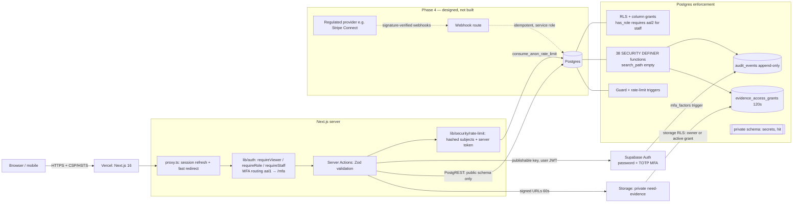
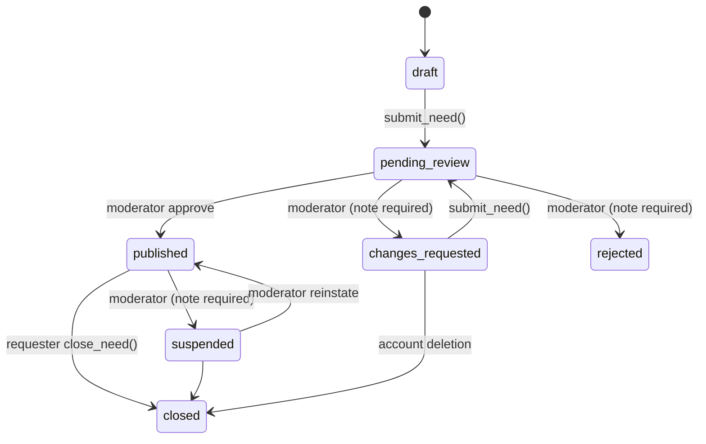

# SolveANeed — Architecture

## 1. System overview

### Principles

1. **The database is the final authority.** Every table has row-level security (RLS). Status changes, moderation, reporting and account deletion go through audited `SECURITY DEFINER` functions. The UI never grants access by hiding things.
2. **Least privilege.** The web app has **no service-role key**. Every query runs as the signed-in user (or as `anon`). Column-level grants stop users writing to protected fields such as `status`, `funded_minor` and `identity_verified_at`.
3. **Business logic is kept apart from presentation.** `lib/domain` and `lib/money` are pure TypeScript with unit tests. Pages and components call `lib/data` (server-only) and server actions.
4. **Defence in depth.** proxy.ts does a quick redirect for signed-out visitors, `lib/auth` guards re-check on every page and action, then RLS, triggers and grants enforce the same rules in Postgres.
5. **Honesty in the product.** There are no fake listings, statistics or testimonials. Empty states say so plainly. Features from later phases say "Coming in Phase N".

## 2. Rendering model

Next.js 16's `cacheComponents` is **off** for Phase 1. Almost every route depends on the signed-in session, and the classic dynamic model (calling `cookies()` makes a route dynamic) is the simplest to reason about for security. Public marketing pages could move to Cache Components later.

- `proxy.ts` (the Next 16 replacement for `middleware.ts`) refreshes the Supabase session on every request. It redirects signed-out users away from `/dashboard` and `/admin`.
- `lib/auth/session.ts → getViewer()` is the only place the current user is resolved. It uses `auth.getClaims()`, which verifies the JWT, and caches the result per request with React `cache()`.
- Mutations use **Server Actions** (with Next's built-in origin check against CSRF) and Zod validation. Every action re-checks the user's role on the server.

## 3. Roles and authorisation

| Role | How it's granted | Can |
|---|---|---|
| requester | Chosen at sign-up or in Settings | Create, edit (draft or changes requested), submit and close own needs; upload private evidence |
| supporter | Chosen at sign-up or in Settings | Discover, save and report needs; set matching preferences |
| business_rep | Admin only (Phase 5) | — |
| moderator | Admin only | Moderation queue, decisions, reports, suspend/reinstate accounts, view evidence (audit-logged) |
| admin | Admin only | Everything a moderator can do, plus role management and audit logs |

One account can hold both requester and supporter. Users can only switch on `requester` and `supporter` themselves (`set_my_role`). All other roles go through `admin_set_role`.

Staff areas return **404** to non-staff, so they don't reveal that they exist. Setting `REQUIRE_STAFF_MFA=true` requires staff sessions at AAL2 (MFA completed).

## 4. Need lifecycle

The same transitions are defined in `public.need_transition_allowed()` (SQL) and `lib/domain/need-status.ts` (TypeScript). A unit test reads the SQL migration and fails if the two ever differ. The offer state machine (Phase 3) uses the same pattern.

## 5. Money (multi-currency)

- Every amount is `amount_minor BIGINT` + `currency CHAR(3)`, which references the `currencies` table (ISO 4217 code, `minor_unit` exponent, enabled flag, per-currency min/max request).
- Enabled at launch: **GBP, EUR, USD, NGN**. CAD, AUD, JPY (0 decimals) and KWD (3 decimals) are seeded but disabled. Admins can enable them once the payment provider supports them.
- A need has exactly one currency, fixed once submitted. Contributions, offers and refunds **must** match the currency of their parent record (enforced by database triggers). Amounts in different currencies are never added or compared together. On the Explore page, amount filters only apply after a currency is chosen.
- `lib/money` parses user input as text, never through float multiplication. It formats using each currency's own exponent, calculates fees in basis points with half-up rounding, and splits milestones with the largest-remainder method so the parts always sum exactly to the total.

## 6. Matching (Phase 2 foundation)

Matching is rules-based and explainable (`lib/domain/matching.ts`):

1. **Eligibility filters first:** a user never sees their own need, the need must accept a support type the supporter offers, and there is an optional "evidence reviewed only" filter.
2. **Transparent scoring:** points for category, support type, region, within budget, evidence reviewed and identity verified. Each point produces a plain-English reason shown on the card.
3. **Description text is never scored,** so urgent or emotive wording can't buy a higher ranking. AI-assisted recommendations can plug in later behind the same interface, but never to approve payments or make final fraud decisions.

## 7. Files

Evidence goes in the private `need-evidence` bucket under `<owner>/<need>/<uuid>.<ext>`. Uploads are checked on the server (declared type, size of 10 MB or less, and file signature bytes) and limited by rate. Files can only be opened through `/api/evidence/:id`, which:
1. calls `authorise_evidence_access()` (owner or staff only, and staff views are written to the audit log);
2. creates a **60-second** signed URL, which storage RLS checks again;
3. redirects with `Cache-Control: no-store` and `Referrer-Policy: no-referrer`.

## 8. Background jobs (planned)

Phase 1 has no background jobs. Planned durable jobs, using `pg_cron` or Supabase scheduled functions: purge expired rate-limit windows (`purge_rate_limits()` exists), offer expiry, deadline reminders, transactional email, and payment reconciliation (Phase 4).

## 9. Payments (Phase 4, design only)

`lib/payments/provider.ts` defines the provider interface: idempotent create, refund and payout, plus **signature-verified** webhooks. The schema already includes `payment_transactions` (unique idempotency key; `livemode` must be false, enforced by a CHECK constraint), `provider_events` (unique `(provider, event_id)`; only signature-verified events can be stored), `payouts` (approval required), and `refunds` (can never exceed the original payment, in the same currency). Clients cannot write to any of these tables.
